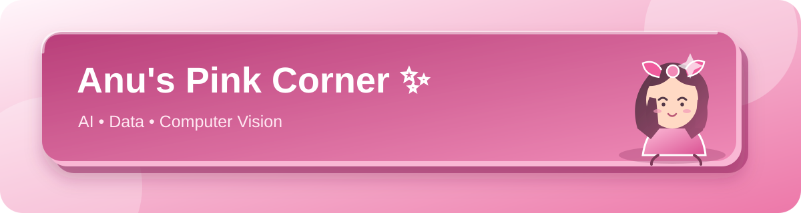

  

  
  
  

<h2 align="center">Welcome to my corner of GitHub 🌸</h2>

I'm Anu. I explore useful AI and data projects, from interactive analysis tools to computer-vision and healthcare analytics prototypes. I enjoy making complex ideas clear, practical, and easy to explore.

  
  
  
  

## ✨ Featured projects

<table>
<tr>
<td width="50%" valign="top">

### 📊 AI Data Analyst Bot

A Streamlit app for cleaning, exploring, charting, and reporting on datasets.

[Open project →](https://github.com/Anuuuuuuu18/ai-data-analyst-bot)

</td>
<td width="50%" valign="top">

### 🛣️ Highway Defect Inspection

A computer-vision project with a demo video and project presentation.

[Open project →](https://github.com/Anuuuuuuu18/Highway-inspection-and-maintenence-using-AI)

</td>
</tr>
<tr>
<td width="50%" valign="top">

### 📦 Pallet Detection

An object-detection project concept for warehouse imagery, with a project presentation.

[Open project →](https://github.com/Anuuuuuuu18/pallet-detection)

</td>
<td width="50%" valign="top">

### 💗 Medical FAQ Prototype

A small Streamlit health-information prototype with clear safety limits.

[Open project →](https://github.com/Anuuuuuuu18/Medical-chatbot)

</td>
</tr>
<tr>
<td width="50%" valign="top">

### 🧩 Sudoku Solver

A notebook-based exploration of search techniques, with a demo recording.

[Open project →](https://github.com/Anuuuuuuu18/Sudoko)

</td>
<td width="50%" valign="top">

### 🏥 Pediatric Hospital Analytics

A healthcare analytics case study and project presentation.

[Open project →](https://github.com/Anuuuuuuu18/Pediatric-hospital-project)

</td>
</tr>
</table>

🌷 More projects

- [Persuasion AI](https://github.com/Anuuuuuuu18/Persuasion-AI) — a concept for transparent language analysis and writing support.
- [Bindu](https://github.com/Anuuuuuuu18/Bindu) — an upstream project fork.

## 💕 GitHub at a glance

  
  

Thanks for visiting — have a lovely day! 🎀

